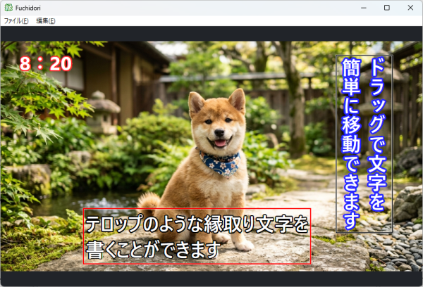

# Fuchidori

画像に縁取り文字や影付き文字を配置できる、Windows 向けのデスクトップアプリです。C++ / ATL / WTL で実装し、描画には Direct2D・DirectWrite、画像の読み書きには WIC を使用しています。

## ダウンロード

最新バージョンは [GitHub Releases](https://github.com/pirozhki/Fuchidori/releases/latest) からダウンロードできます。

- [Fuchidori v1.0.0（ZIP）](https://github.com/pirozhki/Fuchidori/releases/download/v1.0.0/Fuchidori-v1.0.0.zip)
- [すべてのリリースを見る](https://github.com/pirozhki/Fuchidori/releases)

## スクリーンショット

## 主な機能

- PNG / JPEG / BMP / GIF / TIFF 画像の読み込みとドラッグ＆ドロップ
- フォント、サイズ、色、太字、斜体、縦書き・横書きの設定
- 縁取りと影の種類、色、幅のカスタマイズ
- 画像上に複数の文字オブジェクトを空の状態から仮置きし、選択・編集・ドラッグ移動
- ダイアログの削除ボタン、またはオブジェクトの右クリックメニューから削除・確定
- 文字オブジェクトの個別確定と一括確定
- `Ctrl+Z` / `Ctrl+Y` による Undo / Redo
- 確定済み文字を合成した PNG / JPEG / BMP の保存
- 文字オブジェクトごとに文字列・フォント・縁取りなどのプロパティを保持

未確定文字には編集用の枠が表示されます。黒い枠は未選択、赤い枠は選択中を示します。文字が空のオブジェクトにも小さな枠が表示されます。空のオブジェクトを個別確定または一括確定すると削除されます。編集用の枠と未確定文字は保存画像に含まれません。

## 動作環境

- Windows 10 / Windows 11
- Visual Studio 2026（C++ によるデスクトップ開発、ATL）
- Windows SDK
- WTL 10.01

WTL は [WTL 公式サイト](https://wtl.sourceforge.io/) から入手してください。Direct2D、DirectWrite、WIC は Windows SDK のライブラリを使用します。

## ビルド方法

1. Visual Studio で「C++ によるデスクトップ開発」と ATL をインストールします。
2. WTL 10.01 を展開します。
3. 環境変数 `WTL_ROOT` を、`Include/atlapp.h` を含む WTL のルートフォルダーに設定します。たとえば `C:\WTL\Include\atlapp.h` が存在する場合、`WTL_ROOT` は `C:\WTL` です。
4. 必要に応じて 32×32 のアイコンを `src/Fuchidori.ico` に配置します。
5. `Fuchidori.sln` を Visual Studio で開き、`x64` の `Debug` または `Release` 構成でビルドします。

本プロジェクトはランタイムライブラリに静的リンク（Debug: `/MTd`、Release: `/MT`）を使用します。

## 使い方

1. **ファイル → 画像を開く** を選択するか、画像ファイルをウィンドウへドラッグ＆ドロップします。
2. 常時表示される文字設定ダイアログのテキストボックスに文字を入力します。
3. オブジェクトが選択されていない状態で、ダイアログに文字列や書式を準備して画像の何もない場所をクリックすると、その内容で新しいオブジェクトが作成されます。オブジェクトを選択中に何もない場所をクリックした場合、そのクリックでは新規作成せず、まず選択解除だけを行います。選択解除後、必要な文字列や書式をダイアログで準備し、もう一度何もない場所をクリックすると新しいオブジェクトが作成されます。
4. 仮置き文字をクリックすると選択状態になり、ダイアログにその文字のプロパティが表示されます。文字やプロパティを変更すると、選択中のオブジェクトに反映されます。
5. 仮置き文字の枠内をドラッグすると位置を変更できます。黒い枠は未選択、赤い枠は選択中です。
6. **この文字を確定** で選択中の文字だけを確定し、**すべて確定** で未確定オブジェクトを一括確定します。文字が空のオブジェクトは確定時に削除されます。
7. 選択中の文字を削除するにはダイアログの **削除** ボタンを使うか、オブジェクトを右クリックして **削除する** を選びます。右クリックメニューの **確定する** でも選択中のオブジェクトを確定できます。**選択解除** を押すと、選択を解除して初期設定を表示します。
8. **ファイル → 名前を付けて保存** で確定済み文字を画像に合成して保存します。未確定文字や編集枠は保存されません。

### キーボード操作

| キー | 操作 |
| --- | --- |
| `Ctrl+Z` | 元に戻す |
| `Ctrl+Y` | やり直し |
| `Delete` | 選択中の未確定文字オブジェクトを削除 |
| `Esc` | 選択解除 |

文字入力ダイアログのテキストボックスにフォーカスがある場合、`Ctrl+Z` はテキスト編集の取り消しを優先します。

## 設定と一時データ

設定はアプリ起動中のメモリで管理され、終了すると失われます。選択解除状態でダイアログに入力した文字列やプロパティは、画像の空白部分をクリックして新規オブジェクトを作成するときに使われます。オブジェクトを選択中に空白部分をクリックした場合は、最初のクリックで選択解除だけを行います。新規オブジェクトを作成するには、選択解除後に改めて空白部分をクリックしてください。

## ライセンス

[MIT License](LICENSE)
